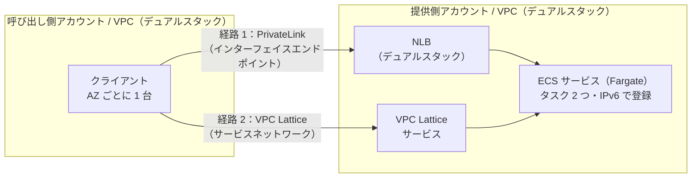

# 検証シナリオ：PrivateLink と VPC Lattice の比較（IPv6 VPC から別 VPC の ECS を呼ぶ）

第 7 版（2026-11-24）／案。AWS 上での実行はしていません。
手順やログ設定などの詳細は [付録](verification-scenario-appendix.md) にあります。

---

## 1. エグゼクティブサマリー

**決めたいこと**
デュアルスタック（IPv4 と IPv6 の併用）の VPC から、別アカウントの VPC にある ECS のサービスを呼ぶ経路を、PrivateLink と VPC Lattice のどちらにするか。

**この検証で判断できるようになること**

| 判断したいこと | 確かめるテスト |
|----------------|----------------|
| 遅延の差は、経路を選ぶ理由になるほど大きいか | L1〜L3 |
| 呼び出し元を IAM の単位で制御・識別する必要があるなら、Lattice でしかできないのか | S1〜S5 |

**予想と根拠**

| 予想 | 根拠 |
|------|------|
| 遅延は PrivateLink のほうが小さい | PrivateLink は NLB で L4（TCP）のまま転送する。Lattice は L7 のプロキシで、HTTP を終端・解釈してから転送する。処理が多い分だけ遅いと推定（実測の資料はなく、推定） |
| ただしその差は 1 ms 前後で、多くの API では決め手にならない | 同じ AZ 内の往復時間を 0.1〜0.3 ms と見込み（推定）、一般的な API の処理時間（数 ms〜数十 ms）と比べて小さいため |
| 制御は Lattice のほうが細かい。Lattice は IAM プリンシパルやパスの単位まで、PrivateLink はアカウントとネットワークの単位まで | Lattice には IAM の認証ポリシーがある（[auth policies](https://docs.aws.amazon.com/vpc-lattice/latest/ug/auth-policies.html)）。PrivateLink の制御は、許可するプリンシパル・接続の承認・セキュリティグループで、AWS 以外のサービス向けのエンドポイントポリシーはフルアクセスになる（付録 E の Q9） |
| 識別も Lattice のほうが細かい | Lattice は呼び出し元の VPC の ARN と、認証時は IAM プリンシパルをヘッダーで渡す（付録 E の Q6）。PrivateLink は、Proxy Protocol v2 で送信元とエンドポイント ID を渡すだけ（付録 E の Q4） |

「推定」と書いたものは、ドキュメントに根拠がなく、検証で確かめる対象です。ドキュメントを根拠にしたものは、付録 E に確かめた日付・判定・出典があります。

**結果からの選び方（実施の前に決めておく）**

| 結果 | 選ぶ経路 |
|------|----------|
| 呼び出し元を IAM プリンシパルの単位で制御・識別したい | Lattice（遅延の差が許容範囲なら） |
| アカウントの単位で足り、遅延を最も重視する | PrivateLink |
| 遅延の差が「差は見られない」と判定された | 制御・識別の要件だけで選ぶ |

**🔴 実施の前に解決が必要なこと**

1. **Lattice のクライアントが IPv6 で接続できるか、ドキュメントで確かめられませんでした。** 構築したら最初に確かめ、できなければ測定に進みません（ゲート G1）。
2. **1 つの ECS サービスに NLB と Lattice を同時につなげるかが未確認です。** つなげない場合の代わりの方法は決めてあります（ゲート G3）。

## 2. 構成

- 同じ ECS サービスの前に NLB と Lattice の両方を置き、経路以外の条件をそろえます。
- 比べる経路は次の 4 つです。
  - **基準**：提供側 VPC の中から、ECS に直接呼ぶ（経路を挟まない遅延）
  - **PrivateLink**
  - **Lattice（認証なし）**
  - **Lattice（IAM 認証あり）**
- 主条件は、クライアントが IPv6 で接続し、ECS も IPv6 で登録する構成です。

## 3. 実施前のゲート

次をすべて満たしてから測定に入ります。1 つでも満たさなければ止めて、シナリオを見直します。

| ID | 確かめること | 満たさないとき |
|----|--------------|----------------|
| G1 | 🔴 呼び出し側から、Lattice のサービス名が AAAA（IPv6 のアドレス）で引け、IPv6 で応答が返る | Lattice を IPv6 で測れない。前提を見直す |
| G2 | 呼び出し側から、PrivateLink のエンドポイント名が AAAA で引け、IPv6 で応答が返る | エンドポイントの設定を直す |
| G3 | 🔴 1 つの ECS サービスに NLB と Lattice を同時につなげる | ECS タスクの IPv6 アドレスを Lattice に直接登録して代わりにする |
| G4 | 4 種類のログ（フローログ、Lattice のアクセスログ、アプリログ、CloudTrail）に、試しに送ったリクエストが記録されている | ログの設定を直す |

確かめ方は付録 A にあります。

## 4. テストケースと判定基準

### 4.1 スピード

すべて、同じ AZ・IPv6・平文の HTTP で、一定の率（50 と 500 リクエスト/秒）で 5 分ずつ、3 回測ります。

| 優先度 | ID | 比べるもの | 予想 | 予想の根拠 | 「予想どおり」とする条件 |
|--------|----|------------|------|------------|--------------------------|
| 🔴 必須 | L1 | PrivateLink と Lattice（認証なし） | Lattice のほうが遅い | L4 の転送と L7 のプロキシの違い（推定） | Lattice − PrivateLink が p50 で 0.5 ms 以上、3 回とも同じ向き |
| 🔴 必須 | L2 | Lattice の認証なしとありの差 | 認証の上乗せは小さい | 署名の検証とポリシーの評価が加わるが、ネットワークの往復は増えない（推定） | 差が p50 で 1 ms 未満 |
| 🟡 推奨 | L3 | L1 を、毎回新しく接続して測る | 差が L1 より広がる | Lattice は接続をプロキシで終端するので、接続の確立に手間が増える（推定） | 差が L1 の差より大きい |

- 「差がある」とする条件は、p50 で 0.5 ms 以上か p99 で 2 ms 以上の差があり、3 回とも同じ向きであることです。満たさなければ「差は見られない」とします。
- **数値の根拠**：数値は依頼者から一任され、こちらで決めました（2026-11-24）。同じ AZ 内の往復時間を 0.1〜0.3 ms と見込み、その 2 倍程度を超える上乗せを差とみなしています。p99 は揺れが大きいため 4 倍の幅をとりました。見込みは実測ではないため、最初に基準を 3 回測り、ばらつきが大きければ、ほかを測る前に条件を引き上げます（付録 B.4）。

### 4.2 セキュリティ

どのテストでも、許可される呼び出しと拒否される呼び出しの両方を試します。

| 優先度 | ID | 確かめること | PrivateLink の予想 | Lattice の予想 | 予想の根拠 |
|--------|----|--------------|--------------------|----------------|------------|
| 🔴 必須 | S1 | 許可していないアカウントから呼べない | ◯ | ◯ | PrivateLink はエンドポイントサービスで許可するプリンシパルと接続の承認を設定できる（[Q1 の出典](https://docs.aws.amazon.com/vpc/latest/privatelink/create-endpoint-service.html)）。Lattice はサービスネットワークを AWS RAM で共有した相手だけが関連付けられる（推定） |
| 🔴 必須 | S2 | IAM プリンシパルや、パス・メソッドの単位で許可・拒否できる | ✗ | ◯ | 付録 E の Q9。Lattice の認証ポリシー（[auth policies](https://docs.aws.amazon.com/vpc-lattice/latest/ug/auth-policies.html)） |
| 🔴 必須 | S3 | 提供側が呼び出し元を何の単位で識別できるか | △ エンドポイント ID（Proxy Protocol v2 が必要）からアカウントをたどる | ◯ ヘッダーで VPC とアカウント、認証ありなら IAM プリンシパル | 付録 E の Q4、Q6 |
| 🔴 必須 | S4 | 呼び出し元が、識別に使う情報を偽装できない | ◯（ECS が NLB からしか受け付けないとき） | ◯（Lattice がヘッダーを取り除く。`x-forwarded-for` は不明） | 付録 E の Q4（NLB を通らない偽装への注意）、Q6（「偽装できない」と明記） |
| 🟡 推奨 | S5 | 誰がいつ呼んだかを、後からログで追える | △ フローログとアプリのログを突き合わせる | ◯ Lattice のアクセスログ | 付録 E の Q10（NLB のアクセスログは TLS のときだけ）。Lattice のアクセスログに送信元 VPC が残る（[access logs](https://docs.aws.amazon.com/vpc-lattice/latest/ug/monitoring-access-logs.html)） |

判定：◯＝設定だけでできる／△＝できるが、アプリの実装などが必要／✗＝できない

## 5. 記録

- 構築の確かめ、測定の生データと集計、セキュリティの証跡、実行ログを、`results/` に残します。
- ログは、リソースを削除する前に `results/` に持ち出します。
- 置き場所とログの設定は付録 C にあります。

## 6. リスクと未確認の事項

| 重大度 | 内容 | 根拠 | 対応 |
|--------|------|------|------|
| 🔴 | Lattice のクライアントが IPv6 で接続できるか不明。資料どうしも食い違う | 付録 E の Q3。Lattice のドキュメントに明記がなく、[AWS services that support IPv6](https://docs.aws.amazon.com/vpc/latest/userguide/aws-ipv6-support.html) では非対応の扱い | ゲート G1 で最初に確かめる |
| 🔴 | ECS サービスに NLB と Lattice を同時につなげるか不明 | 付録 E の Q12。[ECS と Lattice のページ](https://docs.aws.amazon.com/AmazonECS/latest/developerguide/ecs-vpc-lattice.html)には ALB との併用だけが書かれている | ゲート G3。だめなら代わりの方法 |
| 🟡 | Lattice が `x-forwarded-for` を取り除くか不明 | 付録 E の Q6。[HTTP targets](https://docs.aws.amazon.com/vpc-lattice/latest/ug/http-targets.html) は `x-amzn-lattice-*` についてだけ「取り除く」と書いている | S4 で確かめる |
| 🟡 | 判定の数値（0.5 ms）は見込みに基づく | 実測の資料がない（4.1 の「数値の根拠」） | 基準の測定で見直す（付録 B.4） |
| 🟢 | IPv6 のみの構成、AZ をまたぐ場合、TLS ありは扱っていない | 依頼者と主条件をデュアルスタックに決めた（2026-11-24）。範囲を絞って判断しやすくするため | 必要なら付録 D の追加テストを行う |

## 根拠とした情報

- **AWS の公式ドキュメント**：2026-11-24 に確かめました。一覧、判定、出典は付録 E にあります。
- **依頼者との取り決め**（2026-11-24）：IPv6 は「デュアルスタックでいったん」、判定の数値は一任。
- **推定**：遅延の予想（L1〜L3）と、往復時間の見込みは、ドキュメントに根拠がなく、L4 と L7 の処理の違いからの推定です。これらを確かめるのが、この検証の目的です。
- **文書の構成**：スキル「AWS ネットワーク分析」の報告の形（サマリー → 問題点 → 優先度順 → 次のアクション、重大度の表示、Mermaid の構成図）を取り入れました。

## 7. 次のアクション

1. 付録 E の「一部確認」「未確認」の事項を、実施の時点のドキュメントで確かめ直す（1 時間）
2. 構築し、ゲート G1〜G4 を確かめる（1 日＋2 時間）
3. セキュリティ（S1〜S5）を確かめる（半日）
4. 遅延（L1〜L3）を測る（1 日）
5. ログを持ち出してからリソースを削除し、「1. 結果からの選び方」に当てはめて結論を書く（半日）

## 変更履歴

| 版 | 変更内容 | きっかけ |
|----|----------|----------|
| 初版 | 作成 | 最初の依頼 |
| 第 2 版 | IPv6 の前提をデュアルスタックに決定。判定基準の数値の理由を追加 | 依頼者の回答 |
| 第 3 版 | セキュリティの判定基準を追加 | 「目的を達成したか」の問い |
| 第 4 版 | 未確認事項を公式ドキュメントで確認 | 「確認を進めて」との依頼 |
| 第 5 版 | 検証ログの取り方、構築の確かめ方を追加 | 「ログと構築まで考慮できているか」の問い |
| 第 6 版 | 構成を整理し、要点と記号の一覧を追加 | 「読みやすいか」の問い |
| 第 7 版 | 判断に必要なことだけを本文に残し、詳細を付録に分けた。テストを 17 から 8 に絞り、優先度を付けた。結果からの選び方を追加。構成図を Mermaid に。AWS ネットワーク分析のスキルの構成（サマリー → 問題点 → 優先度 → 次のアクション、重大度の表示）を取り入れた | 「長くて判断しづらい。スキルを調べて考え直して」との依頼 |
| 第 7 版（修正） | 第 7 版で本文から落としていた根拠を戻した。予想・テスト・リスクの表に「根拠」の列を足し、「根拠とした情報」の節を追加。ドキュメントに基づくものと推定を区別した | 「根拠とした情報が抜けている」との指摘 |

すべて 2026-11-24 の変更です。
